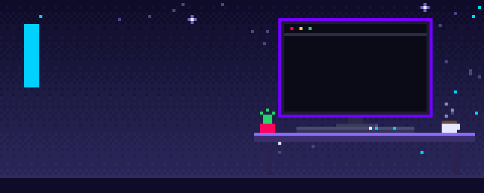

<!-- ================= PIXEL HEADER ================= -->

  

  

  
  
  

  
  
  
  

---

## 🧬 About

> *Complex ideas, turned into elegant, performant experiences that don't just function. They inspire.*

I'm a **Senior Frontend Developer** working where technical precision meets artistic vision: immersive **WebGL / 3D**, fluid **motion design**, and scalable frontend systems.

- 🔭 Building: **Mughal.Dev**
- 🌱 Exploring: WebGPU, React Server Components, AI-driven UI
- 🤝 Open to: creative coding collabs

  <picture>
    <source media="(prefers-color-scheme: dark)" srcset="https://raw.githubusercontent.com/usernamezain/usernamezain/output/github-contribution-grid-snake-dark.svg" />
    
  </picture>

---

## 🧱 Tech Stack

   
   
   
  

  🧊 3D &nbsp;→&nbsp; ⚛️ Frameworks &nbsp;→&nbsp; 🧠 Languages &amp; runtime &nbsp;→&nbsp; 🧱 Foundations 
  <b>Also:</b> GSAP · Framer Motion · React Three Fiber · WebGL / GLSL · GraphQL · Docker · Figma · Git

---

## 🚀 Featured Work

<table>
<tr>
<td width="33%" valign="top">

### [Mughal.Dev](https://zain-mughal.vercel.app)
3D immersive portfolio with WebGL shaders and interactive scenes.

`Three.js` `R3F` `GSAP`

[Repo ↗](https://github.com/usernamezain/mughal-dev)

</td>
<td width="33%" valign="top">

### [Ultimate Empire](https://ultimate-empire.online)
Organic social growth platform with fluid, smooth scrolling.

`React` `GSAP` `Lenis`

[Repo ↗](https://github.com/usernamezain/ultimate-empire)

</td>
<td width="33%" valign="top">

### [Bukhari Designers](https://bukharidesign.com)
Premium agency site for global graphic and UI/UX services.

`React` `TypeScript` `Lenis`

[Repo ↗](https://github.com/usernamezain/bukhari-designers)

</td>
</tr>
</table>

---

## 📊 GitHub Stats

  
  

---

## 🤝 Let's Build Something

  
  

  

