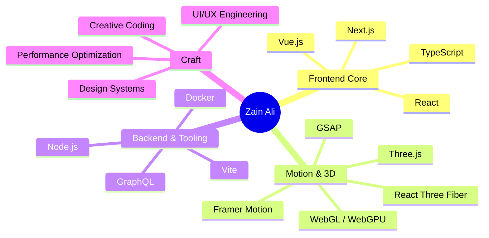
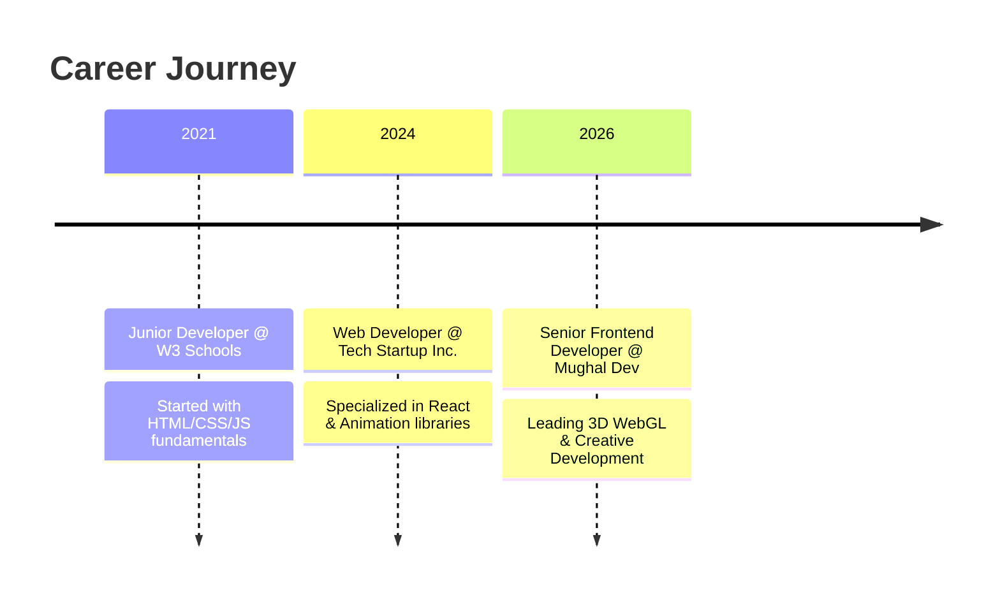
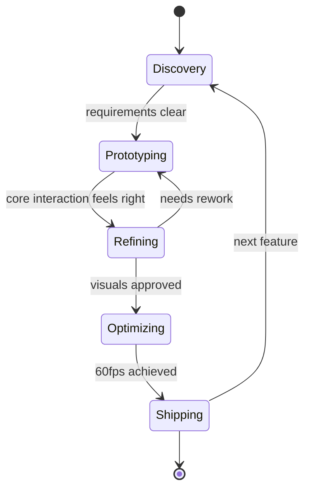

<!-- ================= ANIMATED HEADER ================= -->

  

<!-- ================= TYPING SVG ================= -->

  

<!-- ================= SOCIAL / STAT BADGES ================= -->

  
  
  
  

  
  
  
  

---

## 🧬 About Me

<table>
<tr>
<td width="58%" valign="top">

> *"Transforming complex ideas into elegant, performant digital experiences that don't just function — they inspire."*

I'm a **Senior Frontend Developer** working at the intersection of **technical precision** and **artistic vision**. I architect high-end web applications with a focus on immersive 3D WebGL experiences, fluid motion design, and scalable frontend systems.

</td>
<td width="42%" align="center">
  
   
  
</td>
</tr>
</table>

  

---

## 🧠 Skill Mind Map

---

## 🛠 Tech Stack & Expertise

### Frontend & Core

### Motion & 3D (Creative Tools)

### Backend & Performance

---

## 📊 GitHub Analytics

  
  

  

  

---

## 🚀 Featured Projects

<table>
<tr>
<td width="33%" valign="top">

### 🌐 [Mughal.Dev](https://zain-mughal.vercel.app)
Personal 3D immersive portfolio with WebGL shaders and interactive scenes.

`Three.js` `React Three Fiber` `GSAP`

</td>
<td width="33%" valign="top">

### 🌐 [Ultimate Empire](https://ultimate-empire.online)
Organic social growth platform with fluid scrolling & smooth locomotive scroll.

`React` `GSAP` `Lenis`

</td>
<td width="33%" valign="top">

### 🌐 [Bukhari Designers](https://bukharidesign.com)
Premium agency site for global Graphic & UI/UX services.

`React` `TypeScript` `Lenis`

</td>
</tr>
</table>

---

## 📈 Career Path

---

## ⚙️ How I Work

  

### 🔄 My Build Pipeline

```mermaid
flowchart LR
    A[💡 Idea / Brief] --> B[✏️ Wireframe & Motion Concept]
    B --> C[🎨 Design System Setup]
    C --> D[🧩 Component Architecture]
    D --> E[✨ WebGL / Motion Layer]
    E --> F[⚡ Performance Pass]
    F --> G[🚀 Ship]
    G -.feedback loop.-> B

    style A fill:#0D1117,stroke:#00D1FF,color:#fff
    style B fill:#0D1117,stroke:#7000FF,color:#fff
    style C fill:#0D1117,stroke:#7000FF,color:#fff
    style D fill:#0D1117,stroke:#7000FF,color:#fff
    style E fill:#0D1117,stroke:#FF005C,color:#fff
    style F fill:#0D1117,stroke:#FF005C,color:#fff
    style G fill:#0D1117,stroke:#00D1FF,color:#fff
```

### 🧭 My State of Mind on a Project

### 📅 A Typical Build Week

```mermaid
gantt
    title Weekly Rhythm
    dateFormat  X
    axisFormat %s
    section Discovery
    Client sync & scoping      :done, a1, 0, 1
    Wireframes & motion refs   :done, a2, 1, 2
    section Build
    Component architecture     :active, b1, 2, 4
    WebGL / animation layer    :active, b2, 4, 6
    section Polish
    Performance + a11y pass    :c1, 6, 7
    QA & ship                  :c2, 7, 8
```

### 🧩 Working Style

| Principle | What it means in practice |
|---|---|
| **Motion with purpose** | Every animation earns its frame — nothing moves without guiding attention or giving feedback |
| **Performance first** | 60fps is the baseline, not the goal — I profile before I polish |
| **Systems over one-offs** | Reusable components, design tokens, and typed APIs so the codebase scales with the team |
| **Ship, then iterate** | Fast, testable increments beat perfect-on-paper plans |
| **Design ↔ Dev feedback loop** | I prototype interactions in code early so design decisions are grounded in what actually feels good |

### 🧰 Daily Toolkit

  

---

## 🏆 GitHub Trophies

  

---

## 🤝 Let's Connect & Build

  
  
  
  

<!-- ================= ANIMATED FOOTER ================= -->

  

